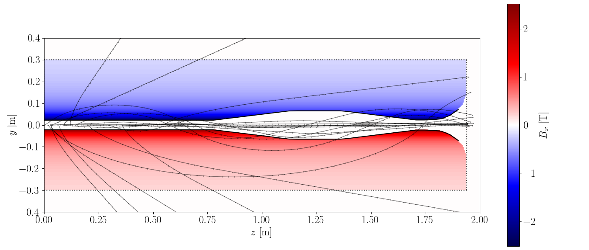
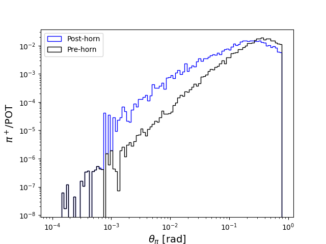
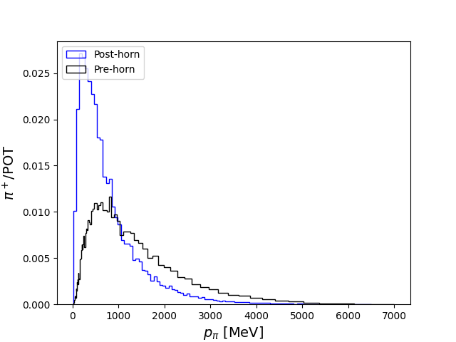

# RKHorn

[](https://doi.org/10.5281/zenodo.14219232)

A lightweight python library for simulating proton beam-induced charged pion fluxes and their radiative transport through a magnetic horn focusing system.

Contact the author: a.thompson@northwestern.edu

#### Requirements
* python 3.11 or later
* matplotlib 3.10.6
* numpy 2.3.3
* scipy 1.16.2
* setuptools 75.8.2
* tqdm 4.67.1


### How it works:
The RKHorn classes implement a very basic set of approximations to model the charged meson fluxes produced at the Booster Neutrino Beam (BNB) target and horn system, with a future possibility of modeling other target and horn systems. There are several main pieces to this model:
* We use the Sanford-Wang (SW) parameterization of the pion ($\pi^+ / \pi^-$) production cross section from 8 GeV protons on beryllium
* Similarly, we implement the Feynman-Scaling (FS) parameterization for $K^+$ production (a modified SW fit is also available)
* The meson yield per proton-on-target is (probability that the proton has a reaction in the 71.1 cm target) $\times$ (meson production cross section) / (p-Be reaction cross section), where "reaction" means inelastic excluding quasi-elastic, 177.5 mb at 8.89 GeV/c
* The charged mesons are propagated through the target and horn according to simple equations of motion solved by Runge-Kutta finite timestep propagation
* When the mesons are in material (the beryllium target, 0.48 cm in radius, or the aluminum inner conductor of the horn), Bethe-Bloch energy loss is applied at each timestep and the meson weight is reduced by its probability of a hadronic interaction, $\exp(-n \sigma \ell)$
* Each timestep update is governed by the Lorentz force law equation of motion, with an azimuthally symmetric magnetic field that is only non-zero between the inner and outer conductors of the horn
* Mesons decay in flight with their own lifetime, inside the horn or downstream of it. A decay counts if it happens before the beam stop (50 m), inside the decay pipe (3 ft radius), and the meson cleared the collimator
* The neutrino flux at the detector is computed analytically from each decayed meson (see below)

Every physics choice, its reference, and its measured effect on the flux is recorded in [PHYSICS_LEDGER.md](../agent_review/PHYSICS_LEDGER.md).

Let's begin with the modeling of the proton beam spot. We take the gaussian profile of the beam spot on the face of the Be target from [1](####references); we simulate $(x_0,y_0,z_0)$ positions and momenta $(p_x,p_y,p_z)$ of the colliding proton beam of total momentum $p = \sqrt{(T_p + m_p)^2 - m_p^2} \simeq 8.9$ GeV,
where $T_p = 8$ GeV kinetic energy, by drawing 

$$ x_0 \sim N(0,\sigma_{x}) $$
$$ y_0 \sim N(0, \sigma_{y}) $$
$$ z_0 \sim Expon(\lambda) $$
$$ p_x \sim p \times N(0, \sigma_{\theta_{x}}) $$
$$ p_y \sim p \times N(0, \sigma_{\theta_{y}}) $$
$$ p_z \sim \sqrt{p^2 - p_x^2 - p_y^2} $$

where $\sigma_{x} = 0.151$ cm, $\sigma_{y} = 0.075$ cm, $\sigma_{\theta_{x}} = 0.66$ mrad, and $\sigma_{\theta_{y}} = 0.40$ mrad, describing the spatial and angular
distribution of the beam spot. The depth $z_0$ into the target at which the proton reacts is drawn from an exponential distribution, restricted to the length
of the target, with the mean free path $\lambda = 1/(n \sigma) \simeq 45.6$ cm given by the p-Be reaction cross section and the Be density.
In the above scheme, we have made some approximations, one for the angular distribution given that the angular spread is very small, and secondly,
we have constrained the total momentum to remain $p$.

Once we record these positions and momenta of the protons where they collide, we sample the distributions and weights of produced pions and kaons
using the differential cross sections under the Sanford-Wang and Feynman-scaling approximations.

Once the mesons are produced, we push their positions and momenta with a finite difference routine. This routine will depend on the meson's current position.
if it resides within the target material, then there is no magnetic field influence, but the meson does lose energy according to the Bethe-Bloch energy loss
per unit distance traveled, $dE/dx$, and it may be absorbed: each step of length $\ell$ in material multiplies its weight by $\exp(-n \sigma \ell)$, with the
pion-nucleus cross sections of [3]. 

If the meson instead resides within the magnetic field region described by $\vec{B}(r,z)$, then we push its momenta and positions according to the Lorentz
force law,

$$ \frac{dp_m}{dt} = \frac{q}{E_m} (\vec{p_m} \times \vec{B}) $$

Finally, each decayed meson contributes to the neutrino flux at the detector without any rejection sampling. For a two-body decay $M \to \mu \nu$ of a meson
with velocity $\beta$ and Lorentz factor $\gamma$, at an angle $\alpha$ to the line from the decay point to the detector a distance $L$ away,

$$ E_\nu = \frac{E^{\ast}}{\gamma (1 - \beta \cos\alpha)}, \qquad \Phi = \frac{\mathrm{BR}}{4 \pi L^2} \frac{1}{\gamma^2 (1 - \beta \cos\alpha)^2}, \qquad E^{\ast} = \frac{m_M^2 - m_\mu^2}{2 m_M} $$

This is the function ```forced_detector_flux```.


#### References:
* [1] "A measurement of hadron production cross-sections for the simulation of accelerator neutrino beams and a search for muon neutrino to electron neutrino oscillations in the $\Delta m^2$ ~ 1 eV$^2$ region" David W. Schmitz, Thesis. [https://inspirehep.net/literature/791454](https://inspirehep.net/literature/791454)
* [2] "Improved Parameterization of K+ Production in p-Be Collisions at Low Energy Using Feynman Scaling" Mariani, Cheng, Conrad, Shaevitz [Phys.Rev.D 84 (2011) 114021] [https://arxiv.org/abs/1110.0417v2](https://arxiv.org/abs/1110.0417v2)
* [3] "Neutrino flux prediction at MiniBooNE" (MiniBooNE Collaboration) [PRD 79, 072002 (2009)] [https://arxiv.org/abs/0806.1449](https://arxiv.org/abs/0806.1449) 

## Example Usage

There are two example files;
* Validation of the neutrino flux against the published MiniBooNE flux [3] is performed by ```python tests/validate_flux.py``` (see "Validation" below)
* See also jupyter/example.ipynb for a notebook walk-through of the following example


#### Simple usage of ```rkhorn``` classes

One calls the ChargedPionFluxMiniBooNE class to simulate the pi+ / pi- / K+ fluxes coming out of the BNB horn geometry. However, with this class the incoming proton energy can be changed as well as the selected horn current in kilo-Amps. Run the examples from inside this directory;

```python
import matplotlib.pyplot as plt
import numpy as np

from constants import BR_PI_MUNU, M_P, M_PI
from rkhorn import ChargedPionFluxMiniBooNE, forced_detector_flux

plt.style.use("custom.mplstyle")

rkhornsim = ChargedPionFluxMiniBooNE(
    proton_energy=8.0e3 + M_P, meson_species="pi_plus",
    solid_angle_cut=0.00924, n_samples=50000, n_pot=1, horn_current=300.0)
```

The meson is chosen with ```meson_species```: ```"pi_plus"```, ```"pi_minus"``` or ```"k_plus"``` (this also sets its charge, mass and lifetime). A positive ```horn_current``` focuses positive mesons (neutrino mode); use a negative current for antineutrino mode. To simulate the beamspot, the production of the mesons, and the focusing, we call
```python
rkhornsim.simulate()
```
which will simulate ```n_samples``` number of weighted Monte-Carlo samples of charged mesons through the horn system. To extract the final momenta, angles, and weights, use
```python
pi_thetas_post_horn = rkhornsim.pip_theta_post_horn
pi_momenta_post_horn = rkhornsim.pip_p_post_horn
pi_weights_post_horn = rkhornsim.pip_wgt_post_horn
```
The weights will be normalized to the number of protons-on-target (POT), ```n_pot``` that the user specifies above.

To get the muon-neutrino flux at MiniBooNE (541 m downstream, on axis) from these mesons:
```python
rkhornsim.simulate(discard_zeros=True)
mesons = rkhornsim.decayed_flux_array()
e_nu, flux = forced_detector_flux(mesons, m_meson=M_PI, br=BR_PI_MUNU)
```


### Plotting example (1)
We can visualize the tracks of the simulated mesons as they transport through the horn system. Let's start by simulating a small number of mesons, just ```n_samples=20```, but keep the histories of each pion by using ```simulate_with_histories()``` instead of ```simulate()```, which returns a list of lists for the x, y, and z positions over time:
```python
rkhornsim2 = ChargedPionFluxMiniBooNE(
    proton_energy=8.0e3 + M_P, meson_species="pi_plus",
    solid_angle_cut=0.00924, n_samples=20, n_pot=1, horn_current=300.0)

xs, ys, zs = rkhornsim2.simulate_with_histories()

horn_start = rkhornsim2.rksolver.horn_start
horn_end = rkhornsim2.rksolver.horn_end

# Plot the horn boundaries
z_values = np.linspace(0.0, 1.9, 50)
y_inner = rkhornsim2.rksolver.inner_radius(z_values)

fig, ax = plt.subplots(figsize=(16, 6))

ax.hlines(y=[-0.3, 0.3], xmin=horn_start, xmax=horn_end, color="k",
          linestyle="dotted")
ax.vlines(x=[horn_start, horn_end], ymin=-0.3, ymax=0.3, color="k",
          linestyle="dotted")
ax.plot(z_values, y_inner, color="k")
ax.plot(z_values, -y_inner, color="k")

for i in range(rkhornsim2.n_samples):
    ax.plot(zs[i], ys[i], color="b", linewidth=1.0, alpha=0.5)

ax.set_aspect("equal")
ax.set_xlabel(r"$z$ [m]")
ax.set_ylabel(r"$y$ [m]")
ax.set_xlim(-0.1, 3.0)
ax.set_ylim(-0.4, 0.4)
fig.tight_layout()
plt.show()
```

Giving us the following nice plot:


Here we can see the pi+ tracks projected onto the y,z plane in blue. Their origins are always inside the BNB target inside the Horn boundary. The step-by-step tracking of each meson stops when it passes the downstream end of the horn (z = 1.94 m), goes backwards past z = 0, decays, stops in material, or after 10000 time steps. Downstream of the horn the mesons fly in a straight line to their decay point.

### Plotting example 2

We can visualize the statistics for many more pions by increasing the sample size to ```n_samples=50000```. This should take several seconds.

```python
rkhornsim = ChargedPionFluxMiniBooNE(
    proton_energy=8.0e3 + M_P, meson_species="pi_plus",
    solid_angle_cut=0.00924, n_samples=50000, n_pot=1, horn_current=300.0)

rkhornsim.simulate()
```

The distributions can then be plotted with
```python
pi_thetas_pre_horn = rkhornsim.meson_flux_pre_horn[:, 1]
pi_momenta_pre_horn = rkhornsim.meson_flux_pre_horn[:, 0]
pi_weights_pre_horn = rkhornsim.meson_flux_pre_horn[:, 2]

pi_thetas_post_horn = rkhornsim.pip_theta_post_horn
pi_momenta_post_horn = rkhornsim.pip_p_post_horn
# the number of pions that decayed pointing within detector solid angle
pi_weights_post_horn = rkhornsim.pip_wgt_post_horn

theta_bins = np.logspace(-4, np.log10(np.pi/4), 100)
momentum_bins = np.logspace(1, np.log10(7000.0), 100)

fig, ax = plt.subplots(figsize=(9, 7))
ax.hist(pi_thetas_post_horn, weights=pi_weights_post_horn, bins=theta_bins,
        histtype="step", color="b", label="Post-horn")
ax.hist(pi_thetas_pre_horn, weights=pi_weights_pre_horn, bins=theta_bins,
        histtype="step", color="k", label="Pre-horn")
ax.set_xscale("log")
ax.set_yscale("log")
ax.set_xlabel(r"$\theta_\pi$ [rad]")
ax.set_ylabel(r"$\pi^+$/POT")
ax.legend(loc="upper left")
fig.tight_layout()
plt.show()
```



This visualizes the effect of the focusing; the pions post-horn are now pointed to lower angles with respect to the beam line, and therefore their decay products (neutrinos) will have a higher flux within the detector solid angle downstream! Notice also that for angles below 1e-3 radians, these pions were created with angles that simply point down the target volume and never enter the magnetic field, so their initial and final angles are the same. We do not simulate the random walk as pions scatter through the target material (yet).



Here we can also look at the pre-horn and post-horn momenta distribution. The post-horn momentta are softer, as expected.


## Validation

```
python tests/test_physics.py     # hand-checkable physics tests (field, kicks, energy loss, decay, cross sections, flux)
python tests/validate_flux.py          # neutrino flux at MiniBooNE vs the published flux, bin by bin
```

```tests/validate_flux.py``` compares the $\nu_\mu$ flux from $\pi^+$ (neutrino mode) and the $\bar{\nu}_\mu$ flux from $\pi^-$ (antineutrino mode) with the curves digitized from [3] (in ```data/public_digitized_fluxes```; these are the pion components of the published flux, Figs. 29 and 31 of [3]). The current level of agreement and the list of effects that are not modeled are in [PHYSICS_LEDGER.md](../agent_review/PHYSICS_LEDGER.md).

## Saved meson samples

```
python simulate_miniboone_meson_fluxes.py                                   # pi+, K+ at +174 kA and pi- at -174 kA
python simulate_miniboone_meson_fluxes.py --species pi_plus --horn-current 0   # horn off
python simulate_miniboone_meson_fluxes.py --format both                     # also rewrite the text tables
```

```simulate_miniboone_meson_fluxes.py``` only writes data. By default it simulates 150000 mesons per species and saves one pickle per sample in ```data/pickle```. A pickle holds, for every simulated meson, the production point, momentum, angle and weight, the same quantities at decay, the decay position, and a flag for decays in the open beamline. Because the mesons themselves are stored, decay products for any detector or decay channel can be computed afterwards without tracking again, and the production model can be varied by reweighting. Read a pickle with ```flux_io.load_meson_pickle``` and convert it to the eight-column table used by ```forced_detector_flux``` with ```flux_io.flux_array```.

The text tables in ```data/``` (decays in the open beamline only, eight columns) are still written by ```--format txt``` or ```--format both```, and by ```python tests/validate_flux.py --save```.

| Folder | Contents |
|---|---|
| ```data/``` | horn profile, text tables of decayed mesons |
| ```data/pickle``` | full meson samples, about 9 MB each |
| ```data/tracks``` | a few pion trajectories for the 3D figure |
| ```data/systematics``` | flux uncertainty envelopes from ```systematics.py``` |
| ```data/bsm_data``` | new-physics fluxes from ```new_physics.py``` |
| ```data/public_digitized_fluxes``` | published MiniBooNE fluxes |
| ```plots/paper``` | figures saved by ```jupyter/paper_plots.ipynb``` |

Notebooks in ```jupyter/```: ```example.ipynb``` is a walk-through of the code, ```plot_fluxes.ipynb``` has quick-look plots of the saved samples, and ```paper_plots.ipynb``` makes and saves the figures of the paper. The last two only read saved data.

## TODO
* secondary meson production by re-interacting protons and neutrons (about 8-10% of the $\nu_\mu$ flux)
* the current distribution inside the inner conductor (skin effect)
* multiple scattering and quasi-elastic scattering of mesons in material; the target sleeve and fins
* neutrinos from muon decay and from three-body kaon decays; $K^-$ and $K^0$ production
* implementing custom horn geometries
* implementing alternative target materials

## Implementing a custom horn geometry

This feature is not yet implemented in a user-friendly way, but you may hack the file ```data/mb_horn_radius_by_z.txt``` which encodes the shape of the inner conductor of the horn as a function of z position.