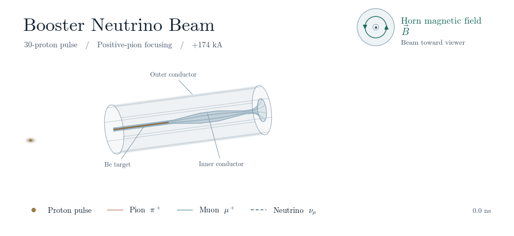
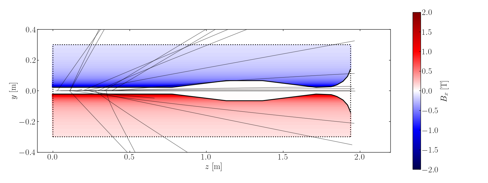
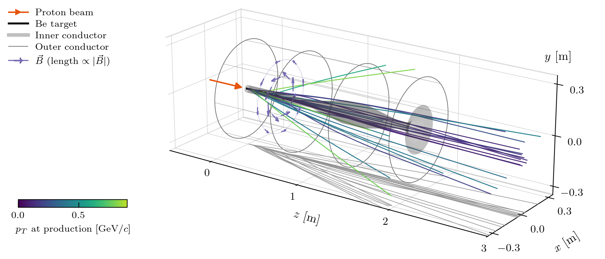
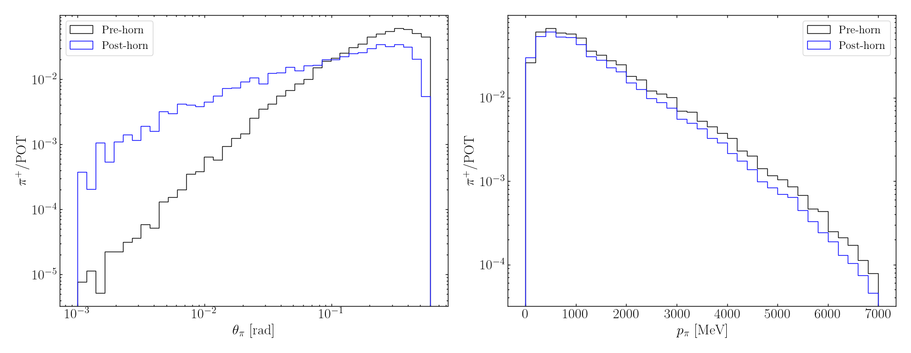
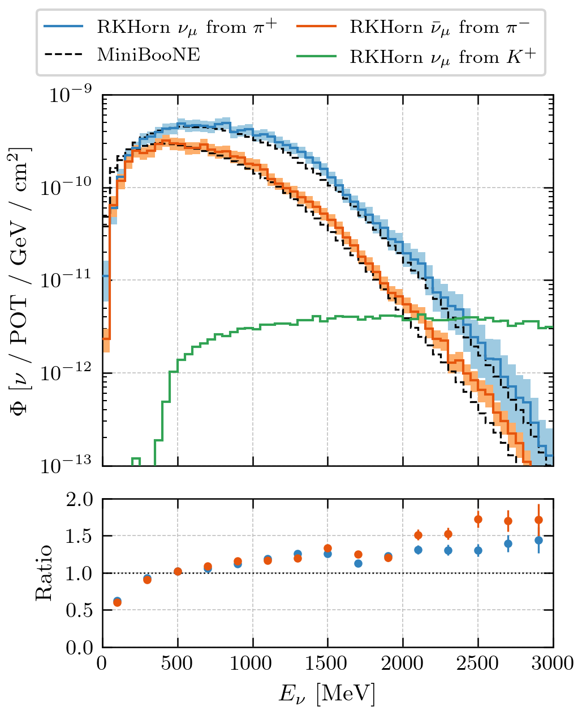
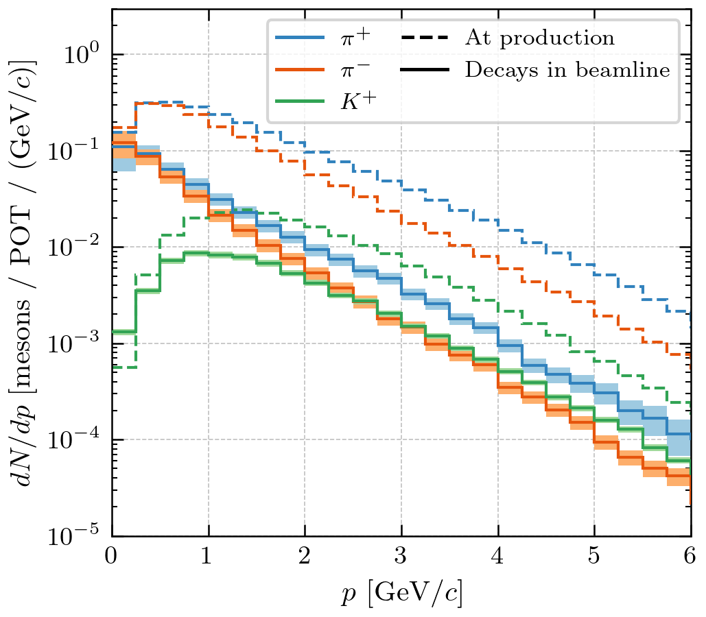
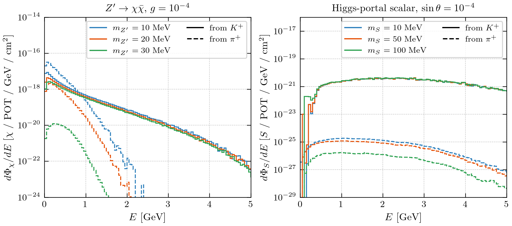

# RKHorn

[](https://doi.org/10.5281/zenodo.14219232)

A lightweight python library for simulating proton beam-induced charged pion fluxes and their radiative transport through a magnetic horn focusing system.

Contact the author: athomps3@uci.edu

#### Requirements
* python 3.11 or later
* matplotlib 3.10.6
* numpy 2.3.3
* scipy 1.16.2
* setuptools 75.8.2
* tqdm 4.67.1


### How it works:
The RKHorn classes implement a very basic set of approximations to model the charged meson fluxes produced at the Booster Neutrino Beam (BNB) target and horn system, with a future possibility of modeling other target and horn systems. There are several main pieces to this model:
* We use the Sanford-Wang (SW) parameterization of the pion ($\pi^+ / \pi^-$) production cross section from 8 GeV protons on beryllium
* Similarly, we implement the Feynman-Scaling (FS) parameterization for $K^+$ production (a modified SW fit is also available)
* The meson yield per proton-on-target is (probability that the proton has a reaction in the 71.1 cm target) $\times$ (meson production cross section) / (p-Be reaction cross section), where "reaction" means inelastic excluding quasi-elastic, 177.5 mb at 8.89 GeV/c
* The charged mesons are propagated through the target and horn according to simple equations of motion solved by Runge-Kutta finite timestep propagation
* When the mesons are in material (the beryllium target, 0.48 cm in radius, or the aluminum inner conductor of the horn), Bethe-Bloch energy loss is applied at each timestep and the meson weight is reduced by its probability of a hadronic interaction, $\exp(-n \sigma \ell)$
* Each timestep update is governed by the Lorentz force law equation of motion, with an azimuthally symmetric magnetic field that is only non-zero between the inner and outer conductors of the horn
* Mesons decay in flight with their own lifetime, inside the horn or downstream of it. A decay counts if it happens before the beam stop (50 m), inside the decay pipe (3 ft radius), and the meson cleared the collimator
* The neutrino flux at the detector is computed analytically from each decayed meson (see below)

Let's begin with the modeling of the proton beam spot. We take the gaussian profile of the beam spot on the face of the Be target from [1](####references); we simulate $(x_0,y_0,z_0)$ positions and momenta $(p_x,p_y,p_z)$ of the colliding proton beam of total momentum $p = \sqrt{(T_p + m_p)^2 - m_p^2} \simeq 8.9$ GeV,
where $T_p = 8$ GeV kinetic energy, by drawing 

$$ x_0 \sim N(0,\sigma_{x}) $$
$$ y_0 \sim N(0, \sigma_{y}) $$
$$ z_0 \sim Expon(\lambda) $$
$$ p_x \sim p \times N(0, \sigma_{\theta_{x}}) $$
$$ p_y \sim p \times N(0, \sigma_{\theta_{y}}) $$
$$ p_z \sim \sqrt{p^2 - p_x^2 - p_y^2} $$

where $\sigma_{x} = 0.151$ cm, $\sigma_{y} = 0.075$ cm, $\sigma_{\theta_{x}} = 0.66$ mrad, and $\sigma_{\theta_{y}} = 0.40$ mrad, describing the spatial and angular
distribution of the beam spot. The depth $z_0$ into the target at which the proton reacts is drawn from an exponential distribution, restricted to the length
of the target, with the mean free path $\lambda = 1/(n \sigma) \simeq 45.6$ cm given by the p-Be reaction cross section and the Be density.
In the above scheme, we have made some approximations, one for the angular distribution given that the angular spread is very small, and secondly,
we have constrained the total momentum to remain $p$.

Once we record these positions and momenta of the protons where they collide, we sample the distributions and weights of produced pions and kaons
using the differential cross sections under the Sanford-Wang and Feynman-scaling approximations.

Once the mesons are produced, we push their positions and momenta with a finite difference routine. This routine will depend on the meson's current position.
if it resides within the target material, then there is no magnetic field influence, but the meson does lose energy according to the Bethe-Bloch energy loss
per unit distance traveled, $dE/dx$, and it may be absorbed: each step of length $\ell$ in material multiplies its weight by $\exp(-n \sigma \ell)$, with the
pion-nucleus cross sections of [3]. 

If the meson instead resides within the magnetic field region described by $\vec{B}(r,z)$, then we push its momenta and positions according to the Lorentz
force law,

$$ \frac{dp_m}{dt} = \frac{q}{E_m} (\vec{p_m} \times \vec{B}) $$

Finally, each decayed meson contributes to the neutrino flux at the detector without any rejection sampling. For a two-body decay $M \to \mu \nu$ of a meson
with velocity $\beta$ and Lorentz factor $\gamma$, at an angle $\alpha$ to the line from the decay point to the detector a distance $L$ away,

$$ E_\nu = \frac{E^{\ast}}{\gamma (1 - \beta \cos\alpha)}, \qquad \Phi = \frac{\mathrm{BR}}{4 \pi L^2} \frac{1}{\gamma^2 (1 - \beta \cos\alpha)^2}, \qquad E^{\ast} = \frac{m_M^2 - m_\mu^2}{2 m_M} $$

This is the function ```forced_detector_flux```.

The animation below shows these steps for an illustrative pulse of 30 protons with the horn at $+174$ kA. The $\pi^+$ tracks (red) bend toward the beam axis in the horn field. Two of the pions decay within the 20 ns shown, each into a muon (blue) and a neutrino (dashed).




#### References:
* [1] "A measurement of hadron production cross-sections for the simulation of accelerator neutrino beams and a search for muon neutrino to electron neutrino oscillations in the $\Delta m^2$ ~ 1 eV$^2$ region" David W. Schmitz, Thesis. [https://inspirehep.net/literature/791454](https://inspirehep.net/literature/791454)
* [2] "Improved Parameterization of K+ Production in p-Be Collisions at Low Energy Using Feynman Scaling" Mariani, Cheng, Conrad, Shaevitz [Phys.Rev.D 84 (2011) 114021] [https://arxiv.org/abs/1110.0417v2](https://arxiv.org/abs/1110.0417v2)
* [3] "Neutrino flux prediction at MiniBooNE" (MiniBooNE Collaboration) [PRD 79, 072002 (2009)] [https://arxiv.org/abs/0806.1449](https://arxiv.org/abs/0806.1449) 

## Example Usage

Two places to start:
* ```jupyter/example.ipynb``` is a notebook walk-through of the example below
* ```python tests/validate_flux.py``` compares the neutrino flux with the published MiniBooNE flux [3] (see "Validation" below)


#### Simple usage of ```rkhorn``` classes

One calls the ChargedPionFluxMiniBooNE class to simulate the pi+ / pi- / K+ fluxes coming out of the BNB horn geometry. However, with this class the incoming proton energy can be changed as well as the selected horn current in kilo-Amps; the BNB runs at 174 kA. Run the examples from inside this directory;

```python
import matplotlib.pyplot as plt
import numpy as np

from constants import BR_PI_MUNU, M_P, M_PI
import flux_io
from rkhorn import ChargedPionFluxMiniBooNE, forced_detector_flux

plt.style.use("custom.mplstyle")

rkhornsim = ChargedPionFluxMiniBooNE(
    proton_energy=8.0e3 + M_P, meson_species="pi_plus",
    n_samples=20000, n_pot=1, horn_current=174.0)
```

The meson is chosen with ```meson_species```: ```"pi_plus"```, ```"pi_minus"``` or ```"k_plus"``` (this also sets its charge, mass and lifetime). A positive ```horn_current``` focuses positive mesons (neutrino mode); use a negative current for antineutrino mode. To simulate the beamspot, the production of the mesons, and the focusing, we call
```python
rkhornsim.simulate(theta_max=0.6)
```
which will simulate ```n_samples``` number of weighted Monte-Carlo samples of charged mesons through the horn system. ```theta_max``` limits the production angle that is sampled; mesons made at wider angles than 0.6 rad do not reach a detector on the beam axis. This takes about half a minute for 20000 mesons. To extract the final momenta, angles, and weights, use
```python
pi_thetas_post_horn = rkhornsim.pip_theta_post_horn
pi_momenta_post_horn = rkhornsim.pip_p_post_horn
pi_weights_post_horn = rkhornsim.pip_wgt_post_horn
```
The weights will be normalized to the number of protons-on-target (POT), ```n_pot``` that the user specifies above.

To get the muon-neutrino flux at MiniBooNE (541 m downstream, on axis) from these mesons:
```python
mesons = rkhornsim.decayed_flux_array()
in_beamline = mesons[:, 5] > 0.0
e_nu, flux = forced_detector_flux(mesons[in_beamline], m_meson=M_PI,
                                  br=BR_PI_MUNU, det_pos=(0.0, 0.0, 541.0))
print(f"nu_mu flux at MiniBooNE: {flux.sum():.2e} nu / cm^2 / POT")
```
This prints a flux close to $6 \times 10^{-10}$ $\nu$ / cm$^2$ / POT. ```decayed_flux_array()``` returns one row per meson with eight columns:

| Column | Quantity |
|---|---|
| 0 | momentum at decay [MeV] |
| 1 | angle to the beam axis at decay [rad] |
| 2, 3, 4 | decay position x, y, z [m]; z is measured from the upstream face of the target |
| 5 | 1 if the decay happens in the open beamline, 0 if the meson hit the collimator, the pipe wall or the beam stop first |
| 6 | weight [mesons per POT], after absorption in material |
| 7 | azimuthal angle of the momentum at decay [rad] |

Only the rows with column 5 equal to 1 should be passed to ```forced_detector_flux```. The detector position ```det_pos``` is in meters, in the same frame as the decay positions, so the flux at any other detector follows from the same mesons.

The full sample, with the production point and momentum of each meson as well, can be saved and read back with ```flux_io```:
```python
record = rkhornsim.meson_record()
flux_io.save_meson_pickle(record, "my_mesons.pkl")
mesons = flux_io.flux_array(flux_io.load_meson_pickle("my_mesons.pkl"))
```
```flux_io.flux_array``` returns the eight-column table for the decays in the open beamline.


### Plotting example (1)
We can visualize the tracks of the simulated mesons as they transport through the horn system. Let's start by simulating a small number of mesons, just ```n_samples=20```, but keep the histories of each pion by using ```simulate_with_histories()``` instead of ```simulate()```, which returns a list of lists for the x, y, and z positions over time. The magnetic field comes from the tracker, ```rksolver.bfield(x, y, z)```, in Tesla:
```python
rkhornsim2 = ChargedPionFluxMiniBooNE(
    proton_energy=8.0e3 + M_P, meson_species="pi_plus",
    n_samples=20, n_pot=1, horn_current=174.0)

xs, ys, zs = rkhornsim2.simulate_with_histories()

solver = rkhornsim2.rksolver
horn_start = solver.horn_start
horn_end = solver.horn_end

# Plot the horn boundaries
z_values = np.linspace(horn_start, horn_end, 200)
y_values = np.linspace(-0.3, 0.3, 200)
y_inner = solver.inner_radius(z_values)
b_x = np.array([[solver.bfield(0.0, y, z)[0] for z in z_values]
                for y in y_values])

fig, ax = plt.subplots(figsize=(16, 6))

mesh = ax.pcolormesh(z_values, y_values, b_x, cmap="seismic",
                     vmin=-2.0, vmax=2.0)
fig.colorbar(mesh, ax=ax, label=r"$B_x$ [T]")
ax.hlines(y=[-0.3, 0.3], xmin=horn_start, xmax=horn_end, color="k",
          linestyle="dotted")
ax.vlines(x=[horn_start, horn_end], ymin=-0.3, ymax=0.3, color="k",
          linestyle="dotted")
ax.plot(z_values, y_inner, color="k")
ax.plot(z_values, -y_inner, color="k")

for i in range(rkhornsim2.n_samples):
    ax.plot(zs[i], ys[i], color="k", linewidth=1.0, alpha=0.6)

ax.set_aspect("equal")
ax.set_xlabel(r"$z$ [m]")
ax.set_ylabel(r"$y$ [m]")
ax.set_xlim(-0.1, 2.2)
ax.set_ylim(-0.4, 0.4)
fig.tight_layout()
plt.show()
```

Giving us the following nice plot:


Here we can see the pi+ tracks projected onto the y,z plane in black, on top of the horn field. The mesons are drawn uniformly in momentum up to 6.5 GeV and in angle up to 90 degrees, so most of these 20 tracks are energetic or leave through the side of the horn, and they bend only slightly. Their origins are always inside the BNB target inside the Horn boundary. The step-by-step tracking of each meson stops when it passes the downstream end of the horn (z = 1.94 m), goes backwards past z = 0, decays, stops in material, or after 10000 time steps. Downstream of the horn the mesons fly in a straight line to their decay point.

The notebook ```jupyter/paper_plots.ipynb``` draws the same kind of tracks in three dimensions, colored by their transverse momentum at production:



### Plotting example 2

We can visualize the statistics with the 20000 pions simulated above, by comparing them at production and after the horn.

```python
pi_thetas_pre_horn = rkhornsim.meson_flux_pre_horn[:, 1]
pi_momenta_pre_horn = rkhornsim.meson_flux_pre_horn[:, 0]
pi_weights_pre_horn = rkhornsim.meson_flux_pre_horn[:, 2]

theta_bins = np.logspace(-3, np.log10(0.6), 40)
momentum_bins = np.linspace(0.0, 7000.0, 36)

fig, axes = plt.subplots(1, 2, figsize=(18, 7))
axes[0].hist(pi_thetas_pre_horn, weights=pi_weights_pre_horn, bins=theta_bins,
             histtype="step", color="k", label="Pre-horn")
axes[0].hist(pi_thetas_post_horn, weights=pi_weights_post_horn,
             bins=theta_bins, histtype="step", color="b", label="Post-horn")
axes[0].set_xscale("log")
axes[0].set_yscale("log")
axes[0].set_xlabel(r"$\theta_\pi$ [rad]")
axes[0].set_ylabel(r"$\pi^+$/POT")
axes[0].legend(loc="upper left")

axes[1].hist(pi_momenta_pre_horn, weights=pi_weights_pre_horn,
             bins=momentum_bins, histtype="step", color="k", label="Pre-horn")
axes[1].hist(pi_momenta_post_horn, weights=pi_weights_post_horn,
             bins=momentum_bins, histtype="step", color="b", label="Post-horn")
axes[1].set_yscale("log")
axes[1].set_xlabel(r"$p_\pi$ [MeV]")
axes[1].set_ylabel(r"$\pi^+$/POT")
axes[1].legend()
fig.tight_layout()
plt.show()
```



The left panel visualizes the effect of the focusing; the pions post-horn are now pointed to lower angles with respect to the beam line, and therefore their decay products (neutrinos) will have a higher flux within the detector solid angle downstream! Below 0.03 rad there are about eight times more pions after the horn than at production. We do not simulate the random walk as pions scatter through the target material (yet).

The right panel shows the momentum distributions. The shape hardly changes, because the magnetic field does no work. The post-horn histogram is lower by about 10% overall (0.50 against 0.56 pions per POT), because the post-horn weights include hadronic absorption in the target and the horn conductor.

## Validation

```
python tests/test_physics.py     # hand-checkable physics tests (field, kicks, energy loss, decay, cross sections, flux)
python tests/validate_flux.py          # neutrino flux at MiniBooNE vs the published flux, bin by bin
```

```tests/validate_flux.py``` compares the $\nu_\mu$ flux from $\pi^+$ (neutrino mode) and the $\bar{\nu}_\mu$ flux from $\pi^-$ (antineutrino mode) with the curves digitized from [3] (in ```data/public_digitized_fluxes```; these are the pion components of the published flux, Figs. 29 and 31 of [3]). The script simulates fresh mesons with a fixed seed and prints the level of agreement.

The figure below makes the same comparison with the saved samples of 150000 mesons per species (see "Saved meson samples"). The shaded bands are the uncertainty from the production fits (see "Production uncertainties").



The ratio of the RKHorn flux to the published one, with the statistical error of the simulation, is

| $E_\nu$ [MeV] | $\nu_\mu$ from $\pi^+$ | $\bar{\nu}_\mu$ from $\pi^-$ |
|---|---|---|
| 0 to 3000 | 1.20 $\pm$ 0.02 | 1.14 $\pm$ 0.02 |
| 0 to 500 | 0.93 $\pm$ 0.02 | 0.88 $\pm$ 0.02 |
| 500 to 1000 | 1.15 $\pm$ 0.03 | 1.19 $\pm$ 0.03 |
| 1000 to 1500 | 1.46 $\pm$ 0.05 | 1.51 $\pm$ 0.05 |
| 1500 to 2000 | 1.90 $\pm$ 0.10 | 2.22 $\pm$ 0.12 |
| 2000 to 3000 | 1.90 $\pm$ 0.18 | 1.76 $\pm$ 0.20 |

The integrated flux is 20% and 14% above the published prediction with no tuned parameters, and the spectrum is too hard above 1 GeV. The effects that are not modeled are listed under "TODO" below.

## Saved meson samples

```
python simulate_miniboone_meson_fluxes.py                                   # pi+, K+ at +174 kA and pi- at -174 kA
python simulate_miniboone_meson_fluxes.py --species pi_plus --horn-current 0   # horn off
python simulate_miniboone_meson_fluxes.py --format both                     # also rewrite the text tables
```

```simulate_miniboone_meson_fluxes.py``` only writes data. By default it simulates 150000 mesons per species and saves one pickle per sample in ```data/pickle```. A pickle holds, for every simulated meson, the production point, momentum, angle and weight, the same quantities at decay, the decay position, and a flag for decays in the open beamline. Because the mesons themselves are stored, decay products for any detector or decay channel can be computed afterwards without tracking again, and the production model can be varied by reweighting. Read a pickle with ```flux_io.load_meson_pickle``` and convert it to the eight-column table used by ```forced_detector_flux``` with ```flux_io.flux_array```.

The text tables in ```data/``` (decays in the open beamline only, eight columns) are still written by ```--format txt``` or ```--format both```, and by ```python tests/validate_flux.py --save```.

| Folder | Contents |
|---|---|
| ```data/``` | horn profile, text tables of decayed mesons |
| ```data/pickle``` | full meson samples, about 9 MB each |
| ```data/tracks``` | a few pion trajectories for the 3D figure |
| ```data/systematics``` | flux uncertainty envelopes from ```systematics.py``` |
| ```data/bsm_data``` | new-physics fluxes from ```new_physics.py``` |
| ```data/public_digitized_fluxes``` | published MiniBooNE fluxes |
| ```plots/paper``` | figures saved by ```jupyter/paper_plots.ipynb``` |
| ```plots/``` | figures shown in this README |

Notebooks in ```jupyter/```: ```example.ipynb``` is a walk-through of the code, ```plot_fluxes.ipynb``` has quick-look plots of the saved samples, and ```paper_plots.ipynb``` makes and saves the figures of the paper. The last two only read saved data.

## Production uncertainties

```
python systematics.py                 # 1000 parameter sets, writes data/systematics
```

```systematics.py``` propagates the uncertainty of the meson production fits to the meson and neutrino fluxes. It draws 1000 sets of Sanford-Wang and Feynman-scaling parameters from the covariance matrices of [3], reweights the saved mesons for each set, and stores the nominal spectra with their bands in ```data/systematics```. No meson is tracked again. The uncertainty on the neutrino flux at MiniBooNE below 3 GeV is 13% for $\pi^+$, 15% for $\pi^-$ and 7% for $K^+$. Only the parameters of the production fits are varied.



## New-physics fluxes

```
python new_physics.py                 # writes data/bsm_data
```

```new_physics.py``` shows how the saved mesons give the flux of a new particle at a detector. It computes two examples at SBND, 110 m from the target on the beam axis:
* dark matter from a muon-philic $Z'$ made in $\pi^+, K^+ \to \mu^+ \nu_\mu Z'$, with $Z' \to \chi \bar{\chi}$
* a long-lived Higgs-portal scalar $S$ made in $K^+ \to \pi^+ S$ and $\pi^+ \to \ell^+ \nu S$

The couplings ($g = 10^{-4}$ and $\sin\theta = 10^{-4}$) are benchmarks chosen for illustration. The fluxes scale with the square of the coupling.



## TODO
* secondary meson production by re-interacting protons and neutrons (about 8-10% of the $\nu_\mu$ flux)
* the current distribution inside the inner conductor (skin effect)
* multiple scattering and quasi-elastic scattering of mesons in material; the target sleeve and fins
* neutrinos from muon decay and from three-body kaon decays; $K^-$ and $K^0$ production
* implementing custom horn geometries
* implementing alternative target materials

## Implementing a custom horn geometry

This feature is not yet implemented in a user-friendly way, but you may hack the file ```data/mb_horn_radius_by_z.txt``` which encodes the shape of the inner conductor of the horn as a function of z position.